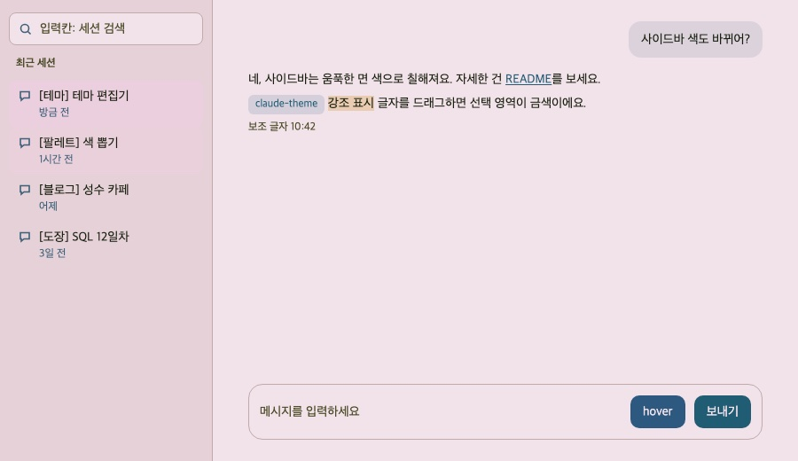
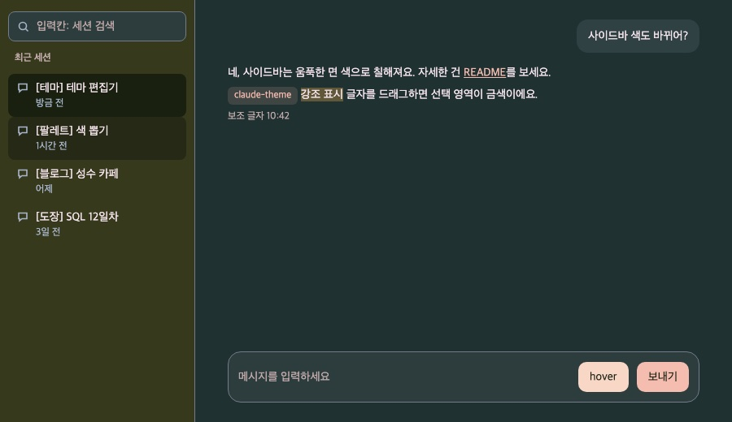
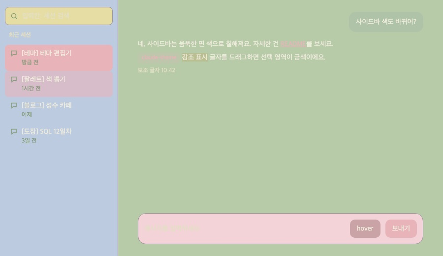

# Claude 테마 편집기

Claude 데스크톱 앱(macOS)의 색을 바꾸는 테마 편집기와 DevTools 스니펫이에요.
- **편집기**(`editor.html`): 글자, 아이콘, 버튼, 사이드바 같은 칸마다 색을 고르면서 앱처럼 생긴 미리보기로 바로 확인해요. 다 고르면 앱에 붙일 코드를 복사해 줘요.
- **스니펫**(`claude-theme.snippet.js`): 앱의 개발자 도구에서 실행하면 앱 CSS 변수를 덮어쓰는 `<style>` 하나를 넣어요. 그 외에는 아무것도 바꾸지 않아요.

비공식 방법이에요. Claude 앱 4.29.0에 맞춰 만들었고, 앱 업데이트로 변수 이름이 바뀌면 일부 색이 원래대로 돌아올 수 있어요(앱이 고장 나지는 않아요).

## 예시 테마
| dreamcore 낮 | dreamcore 밤 | vintage-pastel 낮 |
|---|---|---|
|  |  |  |

- `dreamcore`: 바랜 필름 같은 몽환적인 색. 낮은 분홍빛 흰 바탕에 청록 버튼, 밤은 짙은 청록 바탕에 복숭아 버튼. 낮/밤 모두 글자 대비 4.5:1 이상
- `vintage-pastel`: 90년대 사무실 같은 빈티지 파스텔. 밝은 색끼리 겹쳐 글자가 배경에 녹아드는 게 의도라 글자 대비가 낮아요(1.2~1.6:1). 낮에만 있고 밤은 dreamcore 밤과 같아요

(그림은 앱과 같은 변수 이름을 쓰는 목업 화면 `mockup.html`이에요. 실제 앱 화면이 아니에요.)

## 편집기로 내 테마 만들기
1. 이 저장소 폴더에서 로컬 서버를 띄우고 `http://127.0.0.1:8000/editor.html`을 열어요. 편집기가 스니펫 파일을 읽어야 해서 파일을 바로 열면 안 돼요.

   ```bash
   python3 -m http.server 8000 -b 127.0.0.1
   ```
   `-b 127.0.0.1`은 내 컴퓨터에서만 열리게 하는 옵션이에요. 빼면 같은 Wi-Fi의 다른 기기에서도 폴더가 보여요.
2. 위쪽에서 시작할 테마와 낮/밤을 골라요.
3. 바꿀 곳을 골라요. 오른쪽 미리보기에서 사이드바, 버튼, 글자 같은 곳을 바로 누르거나 왼쪽 칸 목록에서 눌러요. 고른 칸은 미리보기에 파란 테두리로 보여요.
4. 가운데 팔레트 색을 누르면 바로 들어가요. 팔레트에 없는 색은 칸 왼쪽 네모를 눌러 직접 골라요. 글자 칸 옆 숫자는 글자 대비예요(4.5 이상이면 잘 읽혀요).
5. 잘못 바꿨으면 **되돌리기**(Cmd+Z), 처음부터 다시 하려면 **처음 값으로**를 눌러요. 고친 색은 브라우저에 자동 저장돼서 새로 고쳐도 남아요.
6. 다 됐으면 테마 이름과 설명을 적고:
   - 앱에 바로 쓰려면 **앱에 붙일 스니펫 복사**를 눌러요. 이 테마가 들어간 스니펫 전체가 복사돼요. 아래 "앱에 적용하기"의 3단계에서 이걸 붙여 넣어요.
   - 이 저장소에 테마로 남기려면 **테마 코드 복사**를 눌러요. 첫 줄은 스니펫의 `THEME_LIST`에, 나머지 덩어리는 `THEMES`에 붙여 넣어요.

**팔레트(선택)**: 저장소 폴더와 나란히 `palettes/` 폴더를 두고, 그 안의 md 파일 표에 `` `#RRGGBB` `` 형식으로 색을 적어 두면 편집기 팔레트에 나와요. 이때는 두 폴더를 담은 상위 폴더에서 서버를 띄우고 `http://127.0.0.1:8000/<저장소 폴더 이름>/editor.html`로 열어요. `palettes/`가 없으면 예시 테마에 쓰인 색이 팔레트로 나와요.

## 앱에 적용하기
메뉴 이름은 앱 언어에 따라 달라서 한국어와 영어를 같이 적었어요. 개발자 도구(DevTools) 안은 영어로 나올 수 있어요.

### 1. 개발자 모드 켜기 (처음 한 번만)
1. Claude 앱을 앞에 띄운 상태에서 화면 맨 위 메뉴 막대를 봐요.
2. **도움말 > 문제 해결 > 개발자 모드 활성화…** (Help > Troubleshooting > Enable Developer Mode…)를 눌러요.
3. 경고 창에서 **활성화**(Enable)를 눌러요. 메뉴 막대에 **개발자**(Developer) 메뉴가 새로 생겨요.

### 2. 개발자 도구 열기
**개발자 > 개발자 도구 표시** (Developer > Show Dev Tools)를 눌러요. 단축키는 Option+Cmd+I예요.

### 3. 스니펫 저장하기
스니펫(Snippet)은 개발자 도구 안에 저장해 두는 작은 코드 파일이에요. 한 번 저장해 두면 앱을 다시 켤 때 실행만 하면 돼요.
1. `claude-theme.snippet.js`를 전부 복사해요. 편집기에서 만든 테마면 **앱에 붙일 스니펫 복사**로 복사한 걸 써요.
2. 개발자 도구 맨 위 탭 줄에서 **Sources**(소스)를 눌러요. 안 보이면 탭 줄 오른쪽 끝 **>>**에 있어요.
3. Sources 화면 왼쪽 칸 위의 작은 탭들(Page, Workspace…) 중 **Snippets**(스니펫)를 눌러요. 안 보이면 그 줄의 **>>**를 눌러요. 왼쪽 칸 자체가 없으면 왼쪽 위 사이드바 모양 아이콘(Show navigator)을 눌러요.
4. **+ New snippet**을 누르고, 생긴 `Script snippet #1`의 이름을 `claude-theme`으로 바꾼 뒤 Enter를 눌러요.
5. 오른쪽 편집 칸을 누르고 붙여 넣어요(Cmd+V). 이미 있던 스니펫이면 내용을 전부 지우고 붙여 넣어요.
   - 붙여 넣기 경고가 뜨면 안내대로 `allow pasting`을 입력하고 Enter를 누른 뒤 다시 붙여 넣어요. 모르는 코드를 붙여 넣는 사고를 막는 경고예요. 믿을 수 있는 코드만 붙여 넣어요.
6. Cmd+S로 저장해요. 이름 옆 `*` 표시가 사라지면 저장된 거예요.

### 4. 실행하기
편집 칸을 누른 상태에서 Cmd+Enter를 눌러요. 바로 앱 색이 바뀌어요. 아래쪽 Console(콘솔)에 `[claude-theme] <테마 이름> 적용됨`이 나오면 성공이에요(Console이 안 보이면 Esc를 눌러 열어요). 다 끝나면 개발자 도구는 닫아도 돼요.

### 테마 고르기
스니펫 맨 위 `THEME_LIST`에 고를 수 있는 테마 이름과 설명이 있어요. 그중 하나를 바로 아래 `const PICK = '...';`에 적고 다시 실행해요. 없는 이름을 적으면 Console에 고를 수 있는 이름을 보여 줘요.

### 낮/밤 전환
- 앱 설정의 화면 모드(라이트/다크/시스템)가 **시스템**이면 macOS 라이트/다크를 따라 낮/밤이 바뀌어요.
- 앱을 라이트나 다크로 고정했다면 그쪽 테마만 나와요.

### 되돌리기
Console 칸에 `document.getElementById('claude-theme')?.remove();`를 입력하고 Enter를 눌러요. 앱을 다시 시작해도 원래 색으로 돌아가요. `revert.snippet.js`를 스니펫으로 저장해 둬도 돼요.

## 앱을 다시 시작했을 때
테마는 앱을 끄면 사라져요. 앱에는 사용자 색을 저장해 두는 기능이 없어서 켤 때마다 한 번 실행해야 해요. 키보드로 하면 5초면 끝나요.
1. Claude 앱에서 Option+Cmd+I로 개발자 도구를 열어요.
2. Cmd+P를 누르고 `!`를 입력하면 저장해 둔 스니펫 목록이 나와요.
3. `claude-theme`을 골라 Enter를 눌러요.

마우스로 하려면 **Sources > Snippets**에서 `claude-theme`을 오른쪽 클릭해 **Run**을 눌러요. 여러 번 실행해도 `<style>`은 하나만 남아요.

## 검사 (Node.js 필요)
```bash
node check.mjs
```
테마마다 글자색과 바탕색 대비, 여러 번 실행해도 `<style>`이 하나인지, 되돌리기, `#RRGGBB`가 아닌 색 값을 거부하는지 확인해요. 대비가 4.5:1(WCAG AA) 아래면 `FAIL`인데, `check.mjs`의 `STRICT`에 든 테마만 실패로 쳐요(흐린 글자가 의도인 테마는 보여 주기만 해요).

목업만 따로 보려면 서버를 띄운 채 `http://127.0.0.1:8000/mockup.html`을 열어요. 주소 뒤에 `?mode=light`, `?mode=dark`, `&pick=<테마 이름>`, `&theme=off`를 붙여 비교해요.

## 앱 업데이트 뒤 색이 일부만 바뀌거나 안 바뀔 때
1. 스니펫이 쓰는 변수와 선택자가 앱에 아직 있는지 확인해요. 앱 파일과 앱이 claude.ai에서 받아 둔 CSS를 같이 봐요(`zstd`가 필요해요, `brew install zstd`). `없음`으로 나온 줄이 고칠 곳이에요.

   ```bash
   node app-vars.mjs
   ```
2. 원래 색으로 남은 영역은 DevTools **Elements** 탭에서 골라, 오른쪽 **Styles**에서 `background`나 `color`에 쓰인 `var(--이름)`을 찾아요.
3. 그 이름을 `claude-theme.snippet.js`의 `appVars()`(사이드바, 카드 같은 틀 요소면 `frameVars()`) 안에 추가하거나 바뀐 이름으로 고쳐요.

## 파일
| 파일 | 내용 |
|---|---|
| `claude-theme.snippet.js` | 테마 본체. 앱 개발자 도구에서 실행하는 코드. 테마 목록, 테마별 색, 앱 변수 연결 |
| `revert.snippet.js` | 테마를 지우는 한 줄 |
| `editor.html` | 테마 편집기 |
| `mockup.html` | 앱처럼 생긴 가짜 화면. 편집기 미리보기와 README 그림에 써요 |
| `check.mjs` | 대비, 중복 실행, 되돌리기, 잘못된 색 값 검사 |
| `app-vars.mjs` | 스니펫이 쓰는 이름이 지금 앱에 있는지 검사 |
