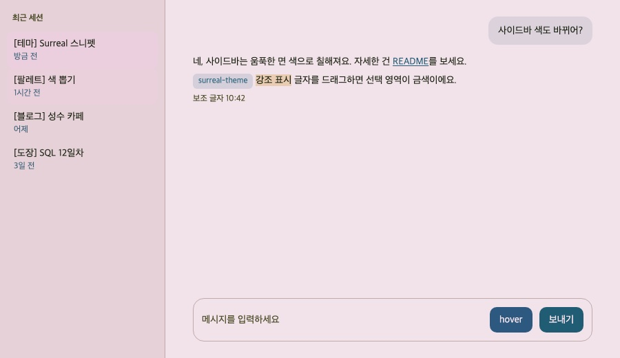
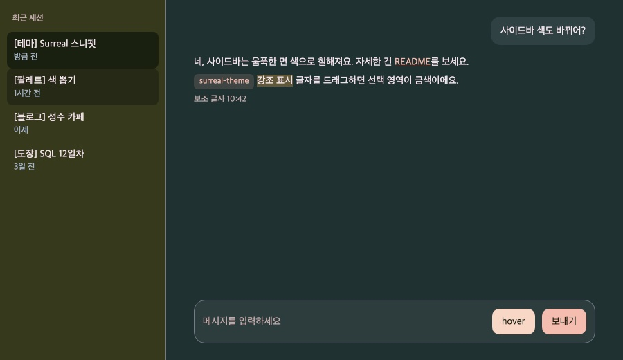
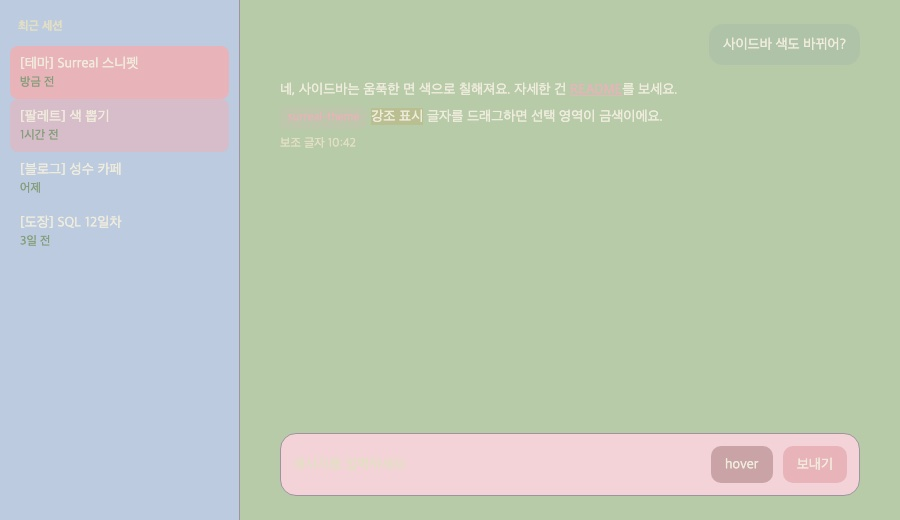

# Claude 데스크톱 앱 색 테마

Claude 데스크톱 앱의 색을 바꾸는 DevTools 스니펫이에요. 테마는 두 가지예요.
- `surreal`: Surreal Series 팔레트. 낮/밤 모두 글자 대비 4.5:1 이상
- `vintage`: 빈티지 파스텔. 낮에만 쓰고 밤은 surreal 밤과 같아요. 밝은 색끼리 겹쳐 글자가 흐린 게 의도라 글자 대비가 1.2~1.6:1이에요

앱 CSS 변수를 덮어쓰는 `<style>` 하나만 추가하고, 그 외에는 아무것도 바꾸지 않아요. 앱 4.29.0에 맞춰 만들었어요.

| surreal 낮 | surreal 밤 | vintage 낮 |
|---|---|---|
|  |  |  |

(위 그림은 앱과 같은 변수 이름을 쓰는 목업 화면 `mockup.html`이에요. 실제 앱 화면이 아니에요.)

## 테마 고르기
`claude-theme.snippet.js` 맨 위 `const PICK = 'surreal';`을 `'vintage'`로 바꾸고 다시 실행해요.

## 낮/밤 전환
- 앱 설정의 화면 모드(라이트/다크/시스템)가 **시스템**이면 macOS 라이트/다크를 따라 낮/밤이 바뀌어요.
- 앱을 라이트나 다크로 고정했다면 그쪽 테마만 나와요.

## 적용하기
1. 처음 한 번만: Claude 앱 메뉴 **Help > Troubleshooting > Enable Developer Mode**를 켜요.
2. **Developer > Show Dev Tools**(Option+Cmd+I)를 열어요.
3. DevTools 위쪽 **Sources** 탭으로 가서, 왼쪽 패널의 Page·Workspace 옆 **>>**를 누르고 **Snippets**를 골라요. **+ New snippet**을 눌러 이름을 `claude-theme`으로 해요.
4. `claude-theme.snippet.js` 내용을 전부 붙여 넣고 Cmd+S로 저장해요.
5. Cmd+Enter로 실행해요. Console에 `[claude-theme] surreal 적용됨`이 나오면 성공이에요.

되돌리기: `revert.snippet.js`도 같은 방법으로 Snippets에 저장해 두고 실행해요. Console에 한 줄(`document.getElementById('claude-theme')?.remove();`)을 직접 쳐도 돼요. 앱을 다시 시작해도 원래 색으로 돌아가요.

## 앱을 다시 시작했을 때
테마는 앱을 끄면 사라져요. 다시 켠 뒤 DevTools > Sources > Snippets에서 저장해 둔 `claude-theme`을 골라 Cmd+Enter만 누르면 돼요. 여러 번 실행해도 `<style>`은 하나만 남아요.

## 색 바꾸기
`claude-theme.snippet.js` 위쪽 색 묶음(`SURREAL_DAY`, `SURREAL_NIGHT`, `VINTAGE_DAY`)만 고치면 돼요. 고친 뒤에는 대비를 확인해요.

```bash
node check.mjs
```

글자색과 바탕색 대비가 4.5:1(WCAG AA, 본문 글자 기준) 아래로 떨어지면 `FAIL`로 알려 줘요. vintage는 대비를 보여 주기만 하고 실패로 치지 않아요. 화면으로 보고 싶으면 `mockup.html`을 브라우저로 열어요(파일을 바로 열면 스니펫을 못 읽어서 로컬 서버로 열어요. `python3 -m http.server`를 이 폴더에서 실행하고 `http://localhost:8000/mockup.html`로 열어요. 주소 뒤에 `?mode=light`, `?mode=dark`, `&pick=vintage`, `&theme=off`로 비교).

## 앱 업데이트 뒤 색이 일부만 바뀌거나 안 바뀔 때
앱이 CSS 변수 이름을 바꾸면 그 부분만 원래 색으로 남아요. 비공식 방법이라 업데이트마다 깨질 수 있어요(테마 때문에 앱이 고장 나지는 않아요. 색만 덮어써요).
1. 스니펫이 쓰는 변수와 선택자가 설치된 앱에 아직 있는지 확인해요. `없음`으로 나온 줄이 고칠 곳이에요.

   ```bash
   node app-vars.mjs
   ```
2. 원래 색으로 남은 영역은 DevTools **Elements** 탭에서 골라, 오른쪽 **Styles**에서 `background`나 `color`에 쓰인 `var(--이름)`을 찾아요.
3. 그 이름을 `claude-theme.snippet.js`의 `appVars()` 안에 추가하거나 바뀐 이름으로 고쳐요. 변수 이름은 이 함수 한 곳에만 있어요.
